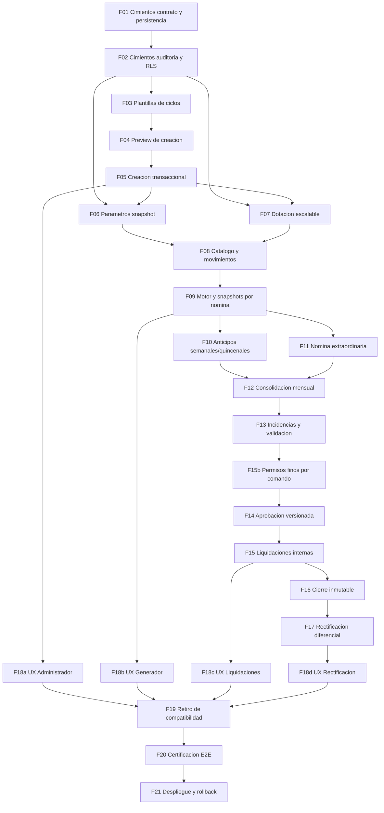

# Roadmap operativo 100 % — Administrador y Generador de nóminas

> ID rector: `NOM-ADMIN-GENERADOR-OPERATIVO-100`
>
> Estado: **Documentado — listo para ejecución por fases**
>
> Fecha base: **2026-06-11**
>
> Versión documental: **v2 (refactor 2026-06-11): F00+F01+F02 fusionadas en F01; F10+F11 fusionadas en F09; F03 partida en F02 cimientos + F15b permisos finos; F20 partida en F18a/b/c/d; F22 partida en F19/F20/F21; anexos A–G añadidos.**
>
> Tipo: producto + dominio + datos + seguridad + cálculo + UX + calidad
>
> Alcance de este documento: **solo planificación documental**. No aplica por sí
> mismo migraciones, cambios Angular, RPC, RLS ni modificaciones al motor.

## 1. Propósito

Convertir el Administrador de nóminas y su Generador de seis pasos en el único
flujo operativo de remuneraciones, capaz de crear, preparar, calcular, validar,
aprobar, liquidar internamente, cerrar y rectificar:

- nóminas mensuales;
- anticipos semanales;
- anticipos quincenales;
- nóminas extraordinarias;
- rectificaciones diferenciales.

El resultado debe ser trazable por nómina, no solamente por mes. Dos nóminas
del mismo período deben poder coexistir sin compartir accidentalmente cálculo,
estado, incidencias o liquidaciones.

## 2. Jerarquía documental

Para ejecutar cualquier fase se debe leer, en este orden:

1. [`../../AGENTS.md`](../../AGENTS.md).
2. [`../../contexto-rapido.md`](../../contexto-rapido.md).
3. [`../../diseno/noia-ui-manual.md`](../../diseno/noia-ui-manual.md), cuando
   la fase incluya UI.
4. [`arquitectura-administrador-generador.md`](./arquitectura-administrador-generador.md).
5. Este roadmap.
6. La auditoría
   [`auditorias/auditoria-admin-generador-nomina-2026-06.md`](./auditorias/auditoria-admin-generador-nomina-2026-06.md).
7. Los archivos reales de código, migraciones y pruebas afectados por la fase.

Si un documento histórico contradice el código actual o este roadmap, se debe
registrar la diferencia y resolverla en la fase documental correspondiente. No
se debe recuperar una ruta o flujo retirado solo porque figure en documentación
anterior.

## 3. Estado real de partida

### 3.1 Flujo visible

- Ruta canónica del Administrador:
  `/remuneraciones/nominas`.
- Ruta canónica del Generador:
  `/remuneraciones/nominas/:nominaPeriodoId`.
- El Generador mantiene **cinco pasos**:
  `Parámetros / Dotación / Movimientos / Cálculo / Cierre`
  (validación automática, aprobación e incidencias viven en Cierre).
- La UI histórica de Nómina mensual fue retirada. La ruta antigua redirige al
  Administrador.
- El chip de mes del menú del Administrador fue retirado.

### 3.2 Persistencia y dominio

- `nomina_periodo` representa la cabecera operativa.
- Dotación, segmentos, movimientos, incidencias y auditoría ya tienen
  persistencia productiva.
- La creación actual carga automáticamente trabajadores aptos y genera una
  dotación general.
- La máquina de estados y la vigencia del cálculo ya cuentan con controles
  iniciales.
- La eliminación está protegida mediante RPC para estados permitidos.

### 3.3 Brechas críticas

- El cálculo todavía se conecta al motor compartido mediante `periodo` y una
  lista de trabajadores.
- Los snapshots de cálculo y las liquidaciones se consultan principalmente por
  `YYYY-MM`, no por `nominaPeriodoId`.
- La semántica semanal, quincenal y extraordinaria no está cerrada en el
  dominio productivo.
- No existe consolidación formal de anticipos o pagos extraordinarios en la
  mensual.
- No existe una rectificación diferencial inmutable vinculada a un cierre.
- Las advertencias no tienen aceptación justificada completa.
- No existen permisos específicos de nómina exigidos por servidor.
- Parte de la metadata del stepper aún proviene de un archivo `*.mock.ts`.
- La prueba E2E actual no cubre creación y ciclo completo.
- Persisten enlaces, nombres y documentación asociados al flujo retirado.

## 4. Decisiones de producto cerradas

Estas decisiones no deben volver a abrirse durante una fase técnica salvo que
aparezca una incompatibilidad legal o contable demostrable. Si una decisión
necesita reabrirse, debe seguirse el mecanismo descrito en el
[Anexo G](#anexo-g--mecanismo-de-reapertura-de-decisiones-cerradas).

| Tema | Decisión |
|---|---|
| Tipos operativos | Mensual, semanal, quincenal y extraordinaria. |
| Semanal/quincenal | Son anticipos, no liquidaciones legales independientes. |
| Regla de anticipo | Porcentaje o monto fijo configurado en plantilla, con ajustes e importación. |
| Mensual | Es la liquidación legal oficial del período. |
| Extraordinaria | Tiene pago interno propio y consolida sus efectos en la mensual. |
| Dotación inicial | Preview automático de contratos que intersectan el rango. |
| Calendario | Plantillas por empresa, editables al crear la nómina. |
| Advertencias | Se resuelven o se aceptan con justificación, usuario y fecha. |
| Bloqueantes | Deben corregirse y requieren recálculo cuando afectan el resultado. |
| Permisos | Son acumulables; un usuario puede ejecutar varias etapas si posee cada permiso. |
| Cierre | Incluye liquidaciones internas; no incluye salidas externas. |
| Corrección posterior | Se crea una rectificación diferencial vinculada. |
| Inmutabilidad | La nómina cerrada y sus liquidaciones publicadas no se editan. |
| Empresa | La empresa activa de la sesión es la fuente única inicial. |

Las decisiones de producto que aún siguen abiertas se listan en el
[Anexo F](#anexo-f--políticas-de-producto-pendientes) y deben cerrarse antes de
iniciar la fase que las requiere.

## 5. Alcance funcional objetivo

```text
Administrador
  -> Previsualizar nueva nómina
  -> Confirmar creación y dotación
  -> Abrir Generador

Generador
  1. Parámetros
  2. Dotación
  3. Movimientos
  4. Cálculo
  5. Validación y aprobación
  6. Liquidaciones internas y cierre

Después del cierre
  -> Consultar liquidaciones y auditoría
  -> Crear rectificación diferencial cuando corresponda
```

El usuario debe poder cerrar el navegador y reanudar desde otro equipo sin
perder estado, decisiones, filtros relevantes, cálculo vigente ni evidencia de
aprobación.

## 6. Fuera de alcance

Este roadmap no incluye:

- transferencias bancarias;
- Previred;
- Libro de Remuneraciones Electrónico;
- centralización contable;
- firma electrónica;
- envío por correo o portal del trabajador;
- generación de PDF como requisito del cierre;
- cambios normativos no relacionados con la identidad y ciclo de la nómina;
- selector multiempresa en la misma sesión.

Estas salidas podrán consumir una nómina cerrada en fases posteriores, pero no
deben bloquear el objetivo interno de este roadmap.

## 7. Arquitectura objetivo

### 7.1 Identidad

`nominaPeriodoId` será la identidad canónica para:

- cabecera;
- dotación;
- segmentos;
- movimientos;
- incidencias;
- cálculo y sus versiones;
- validación y aprobación;
- liquidaciones internas;
- cierre;
- consolidaciones;
- rectificaciones;
- auditoría.

`periodo` seguirá existiendo como dimensión de búsqueda y normativa, pero no
será suficiente para identificar un resultado productivo.

### 7.2 Rangos

Toda nómina operativa tendrá:

- `fechaInicio`;
- `fechaFin`;
- `fechaPago`;
- `periodoLegal`, cuando corresponda;
- `zonaHoraria = America/Santiago`.

Los rangos son inclusivos. La intersección contractual se evalúa con:

```text
inicioContrato <= fechaFinNomina
AND
(finContrato IS NULL OR finContrato >= fechaInicioNomina)
```

La mensual debe cubrir el período legal completo. Los anticipos y
extraordinarias pueden cubrir subrangos o fechas específicas dentro de ese
período.

### 7.3 Naturaleza de la nómina

Se separará la frecuencia visible de la naturaleza contable:

| Campo | Valores iniciales |
|---|---|
| `tipo` | `mensual`, `quincenal`, `semanal`, `extraordinaria` |
| `naturaleza` | `liquidacion_legal`, `anticipo`, `pago_extraordinario`, `rectificacion` |

La rectificación no se presentará como una frecuencia adicional. Será una
naturaleza vinculada a una nómina cerrada.

### 7.4 Versionado

- Cada cálculo tendrá número de versión creciente dentro de una nómina.
- Solo una versión podrá estar vigente.
- Cambios en parámetros, dotación, movimientos o consolidaciones invalidarán
  la versión vigente.
- Una liquidación interna deberá indicar la versión exacta de cálculo usada.
- El cierre congelará la versión de cálculo y la versión de liquidaciones.

### 7.5 Consolidación

La relación entre nóminas se almacenará explícitamente:

- anticipo -> mensual consolidadora;
- extraordinaria -> mensual consolidadora;
- rectificación -> nómina cerrada rectificada.

No se inferirá una relación productiva únicamente porque las nóminas tengan el
mismo mes. La política de elección de mensual consolidadora cuando hay
candidatas múltiples se define en
[Anexo F.1](#f1-elección-de-mensual-consolidadora).

## 8. Estados y transiciones objetivo

### 8.1 Estados principales

```text
borrador
-> dotacion_generada
-> en_revision
-> calculada
-> validada
-> aprobada
-> liquidada
-> cerrada

Estados terminales o excepcionales:
anulada
```

`reabierta` se retirará como mecanismo de corrección posterior al cierre. Una
nómina no cerrada puede volver a revisión mediante invalidación controlada. Una
nómina cerrada se corrige mediante rectificación.

### 8.2 Invariantes

- `calculada` exige cálculo vigente.
- `validada` exige cero bloqueantes pendientes.
- `aprobada` exige advertencias resueltas o aceptadas.
- `liquidada` exige liquidaciones internas asociadas a la versión vigente.
- `cerrada` exige cálculo y liquidaciones congelados.
- `cerrada` y `anulada` son inmutables.
- Una rectificación exige una nómina origen cerrada.
- La mensual no puede aprobarse con consolidaciones pendientes o descuadradas.

## 9. Permisos objetivo

| Permiso | Capacidades |
|---|---|
| `nomina.operar` | Crear, editar parámetros operativos, dotación y movimientos; calcular. |
| `nomina.validar` | Resolver o aceptar incidencias y registrar validación. |
| `nomina.aprobar` | Aprobar una versión validada. |
| `nomina.liquidar` | Generar o regenerar liquidaciones antes del cierre. |
| `nomina.cerrar` | Congelar liquidaciones y cerrar. |
| `nomina.rectificar` | Crear y procesar una rectificación. |
| `nomina.anular` | Anular una nómina dentro de los estados permitidos. |

Los permisos son acumulables. La UI puede ocultar o deshabilitar acciones, pero
la autorización definitiva se ejecutará en RPC/RLS. Cada comando crítico debe
registrar `auth.uid()`, fecha, versión esperada y motivo cuando corresponda.

## 10. Contratos públicos propuestos

Los nombres finales deberán confirmarse contra las convenciones del código en
la fase correspondiente. El comportamiento sí es obligatorio.

### 10.1 Preview de creación

```ts
interface NominaCreatePreviewRequest {
  tipo: TipoNomina;
  plantillaCicloId?: string;
  fechaInicio: string;
  fechaFin: string;
  fechaPago: string;
  reglaAnticipo?: ReglaAnticipoInput;
}

interface NominaCreatePreview {
  incluidos: TrabajadorPreviewNomina[];
  excluidos: TrabajadorExcluidoPreview[];
  conflictos: ConflictoCreacionNomina[];
  totales: {
    incluidos: number;
    excluidos: number;
    bloqueantes: number;
    advertencias: number;
  };
  puedeCrear: boolean;
  fingerprint: string;
}
```

El `fingerprint` impedirá confirmar un preview obsoleto si cambió la dotación o
el calendario entre previsualización y creación.

### 10.2 Contexto de cálculo

```ts
interface NominaCalculoContext {
  nominaPeriodoId: string;
  versionEsperada: number;
  tipo: TipoNomina;
  naturaleza: NaturalezaNomina;
  fechaInicio: string;
  fechaFin: string;
  fechaPago: string;
  parametrosSnapshotId: string;
  trabajadores: TrabajadorCalculoNomina[];
  movimientos: MovimientoCalculoNomina[];
  consolidaciones: ConsolidacionCalculoNomina[];
}
```

### 10.3 Decisión de incidencia

```ts
type EstadoDecisionIncidencia =
  | 'pendiente'
  | 'resuelta'
  | 'aceptada_justificada';

interface IncidenciaDecision {
  incidenciaId: string;
  estado: EstadoDecisionIncidencia;
  justificacion?: string;
  versionCalculo?: number;
}
```

### 10.4 Selección masiva

Las acciones masivas aceptarán una de dos formas excluyentes:

- IDs explícitos;
- criterio filtrado inmutable con exclusiones.

El preview y la ejecución deberán usar la misma huella del filtro para evitar
que una acción afecte un universo distinto al mostrado.

## 11. Reglas generales de ejecución

1. Ejecutar una fase funcional por commit.
2. No mezclar migración, UI y limpieza no relacionada en el mismo commit.
3. Toda migración debe ser aditiva antes de retirar compatibilidad.
4. Toda RPC crítica debe ser transaccional e idempotente.
5. No editar manualmente datos productivos para completar una prueba.
6. No avanzar si la fase introduce tests rojos.
7. Registrar deuda preexistente separada de cualquier regresión nueva.
8. Actualizar este roadmap y `estado-fases` al cerrar cada fase.
9. No retirar compatibilidad hasta tener equivalencia demostrada.
10. Mantener copy RRHH; IDs, enums y nombres de tabla no deben llegar a UI.
11. Toda activación gradual de tipo de nómina debe pasar por el flag tenant
    correspondiente del [Anexo B](#anexo-b--estrategia-de-habilitación-gradual).
12. Toda fase debe declarar esfuerzo categórico
    ([Anexo D](#anexo-d--esfuerzo-categórico-por-fase)) y, cuando aplique,
    métrica técnica objetivo ([Anexo E](#anexo-e--métricas-técnicas-objetivo)).

## 12. Secuencia y dependencias



Notas de paralelismo:

- F06 y F07 pueden avanzar en paralelo después de F02; ambos son insumos de
  F08 y F09.
- F10 y F11 pueden avanzar en paralelo después de F09, siempre que respeten el
  contrato de invalidación definido en F01.
- Las cuatro sub-fases F18a/b/c/d pueden ejecutarse en paralelo siempre que su
  dependencia funcional esté cerrada.
- F15b se inserta entre F13 y F14 porque protege la transición a `aprobada` y
  el resto de comandos críticos, una vez que las RPC ya están escritas.

## 13. Fases detalladas

---

### F01 — Cimientos del contrato y persistencia

**ID:** `NOM-ADMIN-OPS-F01`

**Objetivo**

Fijar la identidad canónica de una nómina, definir el contrato puro
(`tipo`, `naturaleza`, rango, ciclo, versión, vínculos) y persistirlo en base
de datos mediante una migración aditiva con backfill seguro y seed mínimo. Esta
fase fusiona la antigua F00 (línea base), F01 (contrato canónico en modelos
puros) y F02 (persistencia aditiva), porque los modelos TypeScript se derivan
directamente de `database.types.ts` y mantenerlas separadas era ceremonia.

**Dependencias**

- Ninguna.

**Alcance — Diagnóstico (timebox ≤ 1 día)**

- Inventariar rutas canónicas y redirects.
- Listar migraciones aplicadas (local y remoto).
- Identificar tablas, vistas, triggers, RPC y políticas RLS de nómina.
- Mapear servicios que consultan por `periodo`.
- Listar imports runtime desde `*.mock.ts`.
- Registrar suites unitarias, integración y E2E vigentes.
- Medir estado de build y errores preexistentes.

**Alcance — Contrato puro**

- Extender el modelo de `NominaPeriodo` con rango, naturaleza, ciclo y versión.
- Separar `tipo` y `naturaleza`.
- Definir rango inclusivo y período legal.
- Definir vínculo de consolidación (anticipo/extraordinaria -> mensual) y de
  rectificación (rectificación -> cerrada).
- Formalizar estado `liquidada` y cierre inmutable.
- Definir motivos de invalidación de cálculo (parámetros, dotación,
  movimientos, consolidaciones).
- Definir reglas de duplicidad y solapamiento por `tipo` y `naturaleza`.
- Eliminar supuestos implícitos de una nómina por mes en reglas puras.

**Alcance — Persistencia aditiva**

- Migración SQL que agrega columnas (`fecha_inicio`, `fecha_fin`, `fecha_pago`,
  `naturaleza`, `version_calculo`, `ciclo_id`, `nomina_origen_id`,
  `plantilla_ciclo_id`).
- Tablas nuevas: `nomina_plantilla_ciclo`, `nomina_consolidacion`.
- Agregar `nomina_periodo_id` a snapshots de cálculo y liquidaciones.
- Crear índices únicos parciales y checks (una mensual ordinaria por empresa y
  período legal; múltiples anticipos por ciclo; cada rectificación apunta a
  cerrada).
- Incorporar control optimista en comandos críticos (`version_estado`).
- Backfill automático solo cuando empresa + período + evidencia produzcan una
  asociación única.
- Marcar registros ambiguos como históricos pendientes de asociación.
- Mantener lecturas compatibles durante la transición (no eliminar columnas
  legacy en esta fase).

**Alcance — Seed**

- Insertar plantilla `MES` por empresa para que F03 ya disponga de una
  referencia mínima.

**Reglas mínimas**

- Una mensual ordinaria activa por empresa y período legal.
- Múltiples anticipos dentro del período, identificados por ciclo.
- Múltiples extraordinarias, cada una con identidad propia.
- Una rectificación puede tener otras rectificaciones posteriores, pero cada
  una debe apuntar a la versión cerrada original (ver
  [Anexo F.4](#f4-encadenamiento-de-rectificaciones)).
- No se permite cambiar rango, tipo o naturaleza después del primer cálculo
  sin invalidación explícita.

**Migración**

Se ejecuta en tres pasos dentro de la misma fase:

1. columnas y tablas nuevas, inicialmente compatibles;
2. backfill y reporte de ambigüedades;
3. constraints estrictos para registros nuevos.

No se eliminan columnas legacy en esta fase.

**Pruebas**

- Matriz completa de transiciones de estado.
- Rangos válidos e inválidos.
- Solapamientos por tipo.
- Creación de rectificación.
- Inmutabilidad de cerradas.
- Invalidación por cada mutación relevante.
- Conteos antes/después de backfill.
- Registros huérfanos.
- Duplicados por índice objetivo.
- Planes de consulta de Admin, cálculo y liquidaciones.
- RLS de empresa en cada objeto nuevo.
- Build dev + suite v2 + suite nomina-mensual sin regresión.

**Reversión**

- Revertir lectura de aplicación a contratos anteriores.
- Mantener columnas nuevas sin utilizarlas.
- No ejecutar rollback destructivo sobre datos ya vinculados.

**Criterio de cierre**

Toda nómina nueva puede persistir su identidad completa, los datos históricos
siguen disponibles sin asociaciones inventadas, y el dominio puede decidir sin
consultar UI si una operación es válida y qué evidencia invalida cálculo.

**Esfuerzo**

L (ver [Anexo D](#anexo-d--esfuerzo-categórico-por-fase)).

**Fuera de fase**

- Cálculo real.
- Cambios visuales.
- Permisos finos por comando (van en F02 / F15b).

**Commit esperado**

`feat(nomina): cimientos canonicos de contrato y persistencia`

---

### F02 — Cimientos de auditoría y RLS multi-tenant

**ID:** `NOM-ADMIN-OPS-F02`

**Objetivo**

Formalizar la auditoría base y el aislamiento multi-tenant que protegen toda
operación posterior, sin entrar todavía en permisos por comando crítico (eso
va en F15b, cuando las RPC ya existen).

**Dependencias**

- F01 cerrada.

**Alcance**

- Helpers SQL: `current_user_empresa_id()`, `current_user_id()` y verificación
  de pertenencia a empresa.
- Políticas RLS por empresa sobre las tablas nuevas y existentes de nómina.
- Tabla `nomina_auditoria` (si no existe) o extensión de la existente con
  `actor_id`, `fecha`, `estado_previo`, `estado_nuevo`, `version_esperada`,
  `version_resultante`, `motivo`.
- Función auxiliar `registrar_evento_auditoria_nomina(...)` reutilizable desde
  cada RPC.
- Bloqueo explícito de `usuarioId` enviado por el cliente como fuente de
  verdad: la auditoría usa `auth.uid()`.

**Reglas**

- Tener acceso a la empresa no implica permiso de operación sobre nómina.
- Toda RPC debe poder registrar auditoría sin acoplarse al cliente.
- La RLS de empresa es independiente de los permisos finos por comando.

**Pruebas**

- Usuario de otra empresa intentando leer.
- Intento de alterar actor desde cliente.
- Registro de auditoría ante éxito, conflicto optimista y rechazo.
- Verificación de RLS por cada tabla nueva creada en F01.

**Criterio de cierre**

Ninguna lectura ni escritura puede cruzar empresas, y existe un mecanismo
único, estable y probado para registrar auditoría desde cualquier RPC futura.

**Esfuerzo**

S.

**Fuera de fase**

- Asignación de permisos por usuario (eso va en F15b).
- Protección por comando crítico.

**Commit esperado**

`feat(nomina): cimientos de auditoria y rls multi-tenant`

---

### F03 — Plantillas de ciclos por empresa

**ID:** `NOM-ADMIN-OPS-F03`

**Objetivo**

Configurar calendarios repetibles para reducir errores al crear nóminas.

**Dependencias**

- F01 cerrada (`nomina_plantilla_ciclo` ya existe con seed mínimo).
- F02 cerrada (RLS por empresa).

**Alcance**

- Crear plantillas mensual, semanal y quincenal.
- Configurar regla de fecha de pago.
- Configurar porcentaje o monto fijo por defecto para anticipos.
- Permitir activar, pausar y versionar plantillas.
- Previsualizar cortes futuros sin crear nóminas.
- Mantener edición de fechas en la creación.

**Reglas**

- La plantilla propone; la nómina creada congela sus fechas.
- Cambiar una plantilla no modifica nóminas existentes.
- Una plantilla de anticipo debe declarar porcentaje o monto fijo.
- Porcentaje y monto fijo son excluyentes a nivel de regla base.
- Los ajustes por trabajador se aplican después del valor propuesto.

**Pruebas**

- Meses de 28, 29, 30 y 31 días.
- Cambio de año.
- Fecha de pago en fin de semana según política configurada.
- Plantilla inactiva.
- Versionado sin mutar nóminas ya creadas.

**Criterio de cierre**

El sistema puede proponer ciclos válidos para todo un año y cada propuesta
explica sus fechas y regla de anticipo.

**Esfuerzo**

M.

**Commit esperado**

`feat(nomina): incorporar plantillas de ciclos`

---

### F04 — Preview automático de creación

**ID:** `NOM-ADMIN-OPS-F04`

**Objetivo**

Mostrar exactamente qué se creará antes de persistir una nómina.

**Dependencias**

- F01 y F03 cerradas.
- F02 cerrada (RLS de empresa garantiza preview filtrado).

**Alcance**

- Implementar preview en servidor.
- Resolver trabajadores por intersección contractual.
- Separar incluidos y excluidos.
- Informar motivos de exclusión.
- Detectar conflictos de calendario y duplicidad.
- Calcular propuesta de anticipo cuando corresponda (si el `tipo` lo amerita).
- Emitir `fingerprint` del universo evaluado.

**Motivos mínimos de exclusión**

- contrato fuera del rango;
- trabajador inactivo;
- ficha no apta para remuneraciones;
- empresa distinta;
- datos previsionales críticos incompletos;
- exclusión administrativa explícita.

**UX**

- Resumen total.
- Tabs o filtros `Incluidos / Excluidos / Conflictos`.
- Explicación humana por fila.
- Confirmación deshabilitada ante bloqueantes.
- Sin selector de empresa alternativo a la empresa activa.

**Pruebas**

- Contrato inicia o termina en los límites.
- Contratos consecutivos.
- Trabajador con más de un contrato relevante.
- Cambio de datos entre preview y confirmación.
- Nómina duplicada.
- 1.000+ trabajadores con paginación.

**Criterio de cierre**

El usuario conoce el universo y los conflictos antes de crear; confirmar un
preview obsoleto es rechazado.

**Esfuerzo**

M.

**Métrica técnica objetivo**

Ver [Anexo E.1](#e1-preview-y-listados).

**Commit esperado**

`feat(nomina): agregar preview de creacion y dotacion`

---

### F05 — Creación transaccional

**ID:** `NOM-ADMIN-OPS-F05`

**Objetivo**

Crear cabecera, dotación inicial, segmento general y auditoría como una sola
operación idempotente.

**Dependencias**

- F02 y F04 cerradas.

**Alcance**

- RPC de creación basada en preview vigente.
- Clave de idempotencia por intento.
- Congelado de fechas, regla de anticipo y empresa.
- Inserción paginada o set-based de dotación.
- Registro de incluidos, excluidos y motivos.
- Evento de auditoría `creada`.
- Respuesta con siguiente acción y ruta canónica.

**Fallos controlados**

- fingerprint vencido;
- duplicidad por carrera;
- pérdida de permiso;
- trabajador modificado;
- error de inserción parcial;
- reintento de una petición ya confirmada.

**Pruebas**

- Doble clic.
- Dos usuarios creando el mismo ciclo.
- Timeout seguido de reintento.
- Rollback completo ante error.
- Empresa activa distinta a la solicitada.

**Criterio de cierre**

No existe cabecera sin dotación inicial ni dotación sin cabecera por un fallo
parcial de creación.

**Esfuerzo**

M.

**Commit esperado**

`feat(nomina): crear nomina y dotacion en transaccion`

---

### F06 — Parámetros por rango y snapshot

**ID:** `NOM-ADMIN-OPS-F06`

**Objetivo**

Resolver los parámetros aplicables a la nómina por su rango y congelar la
evidencia usada por el cálculo.

**Dependencias**

- F02 y F05 cerradas.

**Alcance**

- Consultar parámetros normativos por vigencia.
- Consultar configuración de empresa aplicable.
- Detectar rangos que cruzan una vigencia normativa.
- Crear snapshot de parámetros por nómina y versión.
- Registrar faltantes críticos y advertencias.
- Rehidratar el paso sin depender del mes global de UI.

**Reglas**

- La mensual usa el período legal correspondiente.
- Un anticipo puede usar una regla simplificada, pero conserva referencias para
  su consolidación posterior.
- Si el rango cruza una vigencia incompatible, se bloquea o se segmenta según
  la capacidad real del motor; no se elige silenciosamente una tasa.
- Recalcular parámetros invalida cálculo posterior.

**Pruebas**

- Vigencia inicia a mitad de mes.
- Parámetro oficial ausente.
- Configuración cliente pendiente.
- Rehidratación.
- Cambio de parámetros después de calcular.

**Criterio de cierre**

Cada cálculo puede demostrar exactamente qué parámetros normativos y de empresa
utilizó.

**Esfuerzo**

M.

**Commit esperado**

`feat(nomina): resolver parametros por rango y snapshot`

---

### F07 — Dotación escalable

**ID:** `NOM-ADMIN-OPS-F07`

**Objetivo**

Operar nóminas grandes por excepción, sin descargar todo el universo al
cliente.

**Dependencias**

- F05 cerrada.

**Alcance**

- Paginación, búsqueda, orden y filtros en servidor.
- Selección por IDs o por universo filtrado.
- Preview masivo inmutable.
- Segmentación por trabajador, centro de costo, cargo, tipo de contrato y
  grupo.
- Inclusión, exclusión, cambio de segmento y marcado de revisión.
- Detalle bajo demanda.
- Conteos agregados sin cargar filas.

**Reglas**

- La selección visual de una página no implica seleccionar todas.
- Seleccionar el universo filtrado debe mostrarse explícitamente.
- Toda mutación de dotación invalida cálculo.
- Un trabajador no puede quedar activo en dos segmentos excluyentes.
- La exclusión exige motivo.

**Pruebas**

- 1.000, 10.000 y volumen objetivo acordado.
- Cambio de página con selección.
- Filtro cambia después del preview.
- Acción parcial fallida.
- Duplicidad de segmento.
- Permisos y empresa.

**Criterio de cierre**

Las acciones masivas afectan exactamente el universo confirmado y la UI no
depende de cargar todos los trabajadores.

**Esfuerzo**

L.

**Métrica técnica objetivo**

Ver [Anexo E.1](#e1-preview-y-listados).

**Commit esperado**

`feat(nomina): escalar dotacion y acciones masivas`

---

### F08 — Catálogo y movimientos consistentes

**ID:** `NOM-ADMIN-OPS-F08`

**Objetivo**

Eliminar tipos libres de movimiento y asegurar que todo concepto tenga reglas
de cálculo, vigencia y consolidación conocidas.

**Dependencias**

- F06 cerrada.
- Catálogo de conceptos operativo.
- Inventario legacy ejecutado según [Anexo C](#anexo-c--inventario-de-tipos-legacy-movimientotipo).

**Alcance**

- Reemplazar `MovimientoTipo = string` en entradas productivas.
- Seleccionar concepto desde catálogo autorizado.
- Validar categoría, unidad, imponibilidad, tributación y vigencia.
- Completar criterios de recurrentes.
- Soportar manual, recurrente, importado y sistema.
- Definir importación con preview, errores por fila e idempotencia.
- Mantener omisiones explícitas.

**Reglas**

- Un concepto inactivo no se agrega a una nómina nueva.
- Un movimiento ya aplicado conserva el snapshot del concepto utilizado.
- La importación nunca crea conceptos nuevos.
- Reaplicar recurrentes no duplica.
- Modificar, omitir o eliminar un movimiento invalida cálculo.

**Pruebas**

- Concepto vencido.
- Concepto de otra empresa.
- Monto y cantidad incompatibles.
- Importación duplicada.
- Recurrente omitido.
- Todos los criterios de segmentación.
- Historial con string legacy bloquea importación nueva pero no edición de
  histórico.

**Criterio de cierre**

No se puede introducir al cálculo un tipo arbitrario o un concepto sin reglas
vigentes.

**Esfuerzo**

L.

**Commit esperado**

`feat(nomina): integrar catalogo productivo de movimientos`

---

### F09 — Contrato del motor y snapshots por nómina

**ID:** `NOM-ADMIN-OPS-F09`

**Objetivo**

Desacoplar la ejecución del cálculo de la clave `YYYY-MM` y persistir
resultados versionados, recuperables y vinculados a la nómina. Esta fase
fusiona las antiguas F10 (contrato del motor) y F11 (snapshot y
rehidratación), porque son el input y el output del mismo refactor.

**Dependencias**

- F06, F07 y F08 cerradas.

**Alcance — Input**

- Construir `NominaCalculoContext`.
- Resolver todo input mediante `nominaPeriodoId`.
- Mantener adaptador temporal hacia reglas compartidas existentes.
- Separar preparación de input, ejecución y persistencia.
- Normalizar errores del motor.
- Registrar huella de entrada para detectar cambios.

**Alcance — Output**

- Crear versión de cálculo por intento exitoso.
- Persistir cabecera, detalle por trabajador y conceptos.
- Marcar una única versión vigente.
- Rehidratar resumen y detalle al recargar.
- Mostrar diferencias respecto de la versión anterior.
- Registrar quién calculó y con qué huella.
- Invalidar sin borrar versiones históricas, según los motivos definidos en
  F01.

**Compatibilidad**

El motor matemático existente puede reutilizarse, pero no decidirá qué nómina,
dotación o movimientos cargar. Esa responsabilidad será del orquestador por
nómina.

**Reglas**

- Un cálculo fallido no desplaza la versión vigente anterior.
- Invalidar no elimina evidencia.
- La UI no obliga a recalcular si existe una versión vigente compatible.
- El cierre referencia una versión concreta.
- Comparación obligatoria contra fixture "golden" del motor actual antes de
  desactivar el adaptador.

**Pruebas**

- Dos nóminas del mismo mes con dotaciones distintas.
- Misma dotación con movimientos distintos.
- Entrada determinista.
- Error de parámetros.
- Error individual por trabajador.
- Comparación contra fixture conocido del motor actual.
- Recarga del navegador.
- Dos cálculos consecutivos.
- Fallo durante persistencia.
- Invalidación por cada origen.
- Consulta histórica.
- Control optimista.

**Criterio de cierre**

El cálculo de una nómina no lee ni sobrescribe datos de otra nómina del mismo
mes, y una nómina calculada puede reabrirse en UI mostrando el mismo resultado
sin reejecutar el motor.

**Esfuerzo**

XL.

**Métrica técnica objetivo**

Ver [Anexo E.2](#e2-motor-y-rehidratación).

**Commit esperado**

`refactor(nomina): contrato del motor y snapshots por nomina`

---

### F10 — Anticipos semanales y quincenales

**ID:** `NOM-ADMIN-OPS-F10`

**Objetivo**

Procesar anticipos internos con reglas configurables y evidencia del pago a
descontar en la mensual.

**Dependencias**

- F03, F08 y F09 cerradas.
- Feature flag `nomina.anticipos.enabled`
  ([Anexo B.1](#b1-flags-disponibles)).

**Alcance**

- Proponer monto por porcentaje o monto fijo.
- Permitir ajuste individual.
- Importar montos con preview.
- Excluir trabajadores con justificación.
- Calcular total de anticipo y líquido interno.
- Generar movimiento de consolidación pendiente hacia la mensual.
- Identificar anticipo pagado, anulado o pendiente.

**Reglas**

- El anticipo no duplica haberes imponibles mensuales.
- El monto pagado se descuenta del líquido mensual.
- Un anticipo anulado no se consolida.
- No se puede consolidar dos veces el mismo pago.
- Ajustes sobre la regla propuesta quedan auditados.
- Política de huérfanos definida en [Anexo F.2](#f2-anticipos-huérfanos).

**Pruebas**

- Porcentaje.
- Monto fijo.
- Ajuste por trabajador.
- Importación.
- Trabajador excluido.
- Anticipo pagado y no pagado.
- Idempotencia de consolidación.

**Criterio de cierre**

El anticipo produce una salida interna trazable y un único descuento futuro
identificable en la mensual.

**Esfuerzo**

L.

**Commit esperado**

`feat(nomina): operar anticipos semanales y quincenales`

---

### F11 — Nómina extraordinaria

**ID:** `NOM-ADMIN-OPS-F11`

**Objetivo**

Procesar pagos extraordinarios con salida interna propia y efectos mensuales
explícitos.

**Dependencias**

- F08 y F09 cerradas.
- Feature flag `nomina.extraordinaria.enabled`
  ([Anexo B.1](#b1-flags-disponibles)).

**Alcance**

- Clasificar conceptos extraordinarios.
- Calcular pago interno.
- Registrar bases imponibles y tributables que deben consolidarse.
- Registrar descuentos y montos previamente pagados.
- Vincular una mensual consolidadora según
  [Anexo F.1](#f1-elección-de-mensual-consolidadora).
- Bloquear conceptos sin política de consolidación.

**Reglas**

- Cada concepto declara si afecta bases mensuales.
- El pago extraordinario ya realizado se descuenta del líquido mensual cuando
  corresponda.
- No se incorporan dos veces bases o pagos.
- La extraordinaria cerrada permanece inmutable.

**Pruebas**

- Bono imponible.
- Haber no imponible.
- Descuento extraordinario.
- Pago previo.
- Concepto sin política.
- Varias extraordinarias en el mismo mes.

**Criterio de cierre**

Para cada extraordinaria es posible explicar qué se pagó y qué efecto exacto
queda pendiente para la mensual.

**Esfuerzo**

L.

**Commit esperado**

`feat(nomina): operar pagos extraordinarios consolidables`

---

### F12 — Consolidación mensual

**ID:** `NOM-ADMIN-OPS-F12`

**Objetivo**

Incorporar anticipos y extraordinarias en la liquidación legal mensual sin
duplicar bases ni pagos.

**Dependencias**

- F10 y F11 cerradas.

**Alcance**

- Descubrir relaciones pendientes del período legal.
- Vincular o desvincular antes de aprobar.
- Incorporar bases extraordinarias.
- Descontar anticipos y pagos previos.
- Mostrar conciliación por nómina origen y trabajador.
- Persistir estado de consolidación.
- Bloquear aprobación ante diferencias.
- Aplicar política de ventana temporal y huérfanos del
  [Anexo F.2](#f2-anticipos-huérfanos) y [Anexo F.3](#f3-ventana-temporal-de-consolidación).

**Cuadraturas mínimas**

- origen cerrado o en estado permitido;
- trabajador presente o tratamiento explícito de ausencia;
- monto origen = monto consolidado;
- cada origen consolidado una sola vez;
- diferencia global igual a cero;
- conceptos con política compatible.

**Pruebas**

- Dos anticipos y una extraordinaria.
- Trabajador termina contrato antes de la mensual.
- Trabajador fuera de dotación mensual.
- Origen anulado.
- Consolidación parcial.
- Reintento y concurrencia.
- Mensual consolidadora elegida automáticamente vs elegida explícitamente por
  usuario.

**Criterio de cierre**

La mensual explica por trabajador los pagos previos y no puede aprobarse con
una conciliación incompleta.

**Esfuerzo**

XL.

**Commit esperado**

`feat(nomina): consolidar anticipos y extraordinarias`

---

### F13 — Incidencias y validación

**ID:** `NOM-ADMIN-OPS-F13`

**Objetivo**

Transformar la validación en un registro de decisiones persistidas y no en una
lista informativa.

**Dependencias**

- F02, F09 y F12 cerradas.

**Alcance**

- Persistir estado de decisión.
- Resolver bloqueantes.
- Aceptar advertencias con justificación.
- Registrar usuario, fecha y versión de cálculo.
- Agrupar por origen, severidad, trabajador y concepto.
- Navegar a la corrección con foco contextual.
- Reabrir incidencias cuando una mutación invalide su decisión.

**Reglas**

- Un bloqueante no puede aceptarse.
- Una advertencia aceptada exige justificación no vacía.
- Una decisión asociada a una versión inválida no habilita aprobación.
- Corregir una incidencia puede invalidar cálculo.
- Incidencias informativas no bloquean.

**Pruebas**

- Resolver bloqueante.
- Intentar aceptar bloqueante.
- Aceptar warning sin motivo.
- Invalidación posterior.
- Navegación a Dotación o Movimientos.
- Permisos.

**Criterio de cierre**

Toda incidencia que habilita la aprobación tiene una decisión válida,
versionada y atribuible.

**Esfuerzo**

M.

**Commit esperado**

`feat(nomina): persistir validacion e incidencias`

---

### F15b — Permisos finos por comando crítico

**ID:** `NOM-ADMIN-OPS-F15b`

> Numerada como F15b porque se inserta entre F13 y F14 para proteger
> aprobación, liquidación, cierre, rectificación y anulación, una vez que sus
> RPC ya están escritas en F09–F13 y antes de habilitarlas en producción.

**Objetivo**

Proteger cada operación crítica con permisos específicos del catálogo del
capítulo 9, ejecutados en servidor con evidencia auditable.

**Dependencias**

- F02 cerrada (cimientos de auditoría + RLS).
- F13 cerrada (incidencias persistidas).

**Alcance**

- Persistir asignación de permisos por usuario y empresa o integrar el
  mecanismo de roles vigente si ya existe uno equivalente.
- Resolver permisos efectivos mediante función SQL estable.
- Proteger RPC de validación, aprobación, liquidación, cierre, rectificación y
  anulación.
- Exponer permisos efectivos al frontend.
- Definir mensajes humanos para autorización insuficiente.

**Reglas**

- Los permisos son acumulables.
- Tener acceso a la empresa no implica permiso de cierre.
- La autorización se evalúa en servidor en cada comando.
- La auditoría no acepta un `usuarioId` enviado por el cliente como fuente de
  verdad; usa `auth.uid()`.

**Pruebas**

- Matriz permiso/acción.
- Usuario sin rol.
- Usuario de otra empresa.
- Permisos acumulados.
- Intento de alterar actor desde cliente.
- Auditoría ante éxito, conflicto optimista y rechazo.

**Criterio de cierre**

Ninguna acción crítica puede ejecutarse mediante llamada directa a Supabase sin
el permiso requerido.

**Esfuerzo**

S.

**Commit esperado**

`feat(nomina): aplicar permisos finos por comando critico`

---

### F14 — Aprobación versionada

**ID:** `NOM-ADMIN-OPS-F14`

**Objetivo**

Registrar una aprobación explícita sobre una versión exacta del cálculo.

**Dependencias**

- F13 y F15b cerradas.

**Alcance**

- Separar comando de validar y aprobar.
- Mostrar resumen de alcance y montos.
- Confirmar mediante `app-message-box`.
- Registrar versión aprobada.
- Exigir permiso `nomina.aprobar` (F15b).
- Invalidar aprobación ante cambios.

**Reglas**

- Validar no aprueba.
- Aprobar no recalcula.
- La aprobación incluye totales y huella de cálculo.
- Un usuario puede operar y aprobar si posee ambos permisos.
- La UI debe mostrar claramente la identidad del aprobador.

**Pruebas**

- Aprobar cálculo vigente.
- Cálculo invalidado entre confirmación y RPC.
- Permiso insuficiente.
- Doble aprobación.
- Mutación posterior.

**Criterio de cierre**

Existe una evidencia inequívoca de quién aprobó qué versión y con qué totales.

**Esfuerzo**

S.

**Commit esperado**

`feat(nomina): separar y versionar aprobacion`

---

### F15 — Liquidaciones internas por nómina

**ID:** `NOM-ADMIN-OPS-F15`

**Objetivo**

Generar, consultar y versionar liquidaciones internas desde una nómina
aprobada.

**Dependencias**

- F01, F09 y F14 cerradas.

**Alcance**

- Consultar por `nominaPeriodoId`.
- Generar desde la versión aprobada.
- Persistir liquidación por trabajador.
- Mostrar resumen, errores y trabajadores sin liquidación.
- Permitir regenerar antes del cierre cuando cambie la versión aprobada.
- Registrar versión y actor.

**Reglas**

- No generar desde período ambiguo.
- No generar desde cálculo no aprobado.
- Una liquidación identifica nómina, cálculo y trabajador.
- Regenerar antes del cierre conserva historial o reemplaza mediante versión,
  nunca mediante actualización silenciosa. Semántica concreta: cada
  regeneración crea una nueva versión de liquidación; la anterior queda
  marcada como `superada`, no eliminada.

**Pruebas**

- Dos nóminas del mismo mes.
- Regeneración.
- Fallo parcial.
- Trabajador sin datos requeridos.
- Permisos.
- Rehidratación y consulta histórica.
- Liquidación `superada` consultable.

**Criterio de cierre**

Cada liquidación interna puede rastrearse hasta una nómina y versión de cálculo
específicas, y la regeneración nunca destruye evidencia.

**Esfuerzo**

M.

**Commit esperado**

`feat(nomina): generar liquidaciones internas por nomina`

---

### F16 — Cierre inmutable

**ID:** `NOM-ADMIN-OPS-F16`

**Objetivo**

Congelar el expediente completo y convertirlo en fuente interna oficial.

**Dependencias**

- F15 y F15b cerradas.

**Alcance**

- Checklist de cierre basado en evidencias persistidas.
- Confirmación crítica.
- Transición transaccional a `cerrada`.
- Congelar cálculo, liquidaciones, consolidaciones y decisiones.
- Bloquear edición y eliminación.
- Exponer acta y auditoría.

**Checklist mínimo**

- parámetros vigentes;
- dotación confirmada;
- movimientos consolidados;
- cálculo vigente;
- cero bloqueantes;
- advertencias tratadas;
- aprobación vigente;
- liquidaciones completas;
- conciliación en cero.

**Pruebas**

- Cierre exitoso.
- Liquidación faltante.
- Cálculo invalidado durante confirmación.
- Intento de edición posterior.
- Intento de reapertura.
- Permiso y concurrencia.

**Criterio de cierre**

Una nómina cerrada no cambia y todo su expediente puede reconstruirse desde
datos persistidos.

**Esfuerzo**

M.

**Commit esperado**

`feat(nomina): cerrar y congelar expediente`

---

### F17 — Rectificación diferencial

**ID:** `NOM-ADMIN-OPS-F17`

**Objetivo**

Corregir una nómina cerrada sin modificarla ni reemplazar su evidencia.

**Dependencias**

- F16 cerrada.
- Feature flag `nomina.rectificacion.enabled`
  ([Anexo B.1](#b1-flags-disponibles)).

**Alcance**

- Crear rectificación desde nómina origen.
- Seleccionar trabajadores y causa.
- Copiar únicamente contexto necesario.
- Calcular diferencias por concepto.
- Generar liquidación diferencial.
- Vincular cadena de rectificaciones según
  [Anexo F.4](#f4-encadenamiento-de-rectificaciones).
- Mostrar acumulado original + diferencias.

**Reglas**

- La nómina origen debe estar cerrada.
- La rectificación exige motivo.
- Solo persiste diferencias, no una copia completa mutable.
- Una diferencia cero no produce línea de liquidación.
- La rectificación tiene su propio ciclo de validación, aprobación y cierre.
- El original nunca cambia de versión ni estado.

**Pruebas**

- Haber omitido.
- Descuento incorrecto.
- Cambio previsional retroactivo.
- Diferencia positiva, negativa y cero.
- Segunda rectificación apunta al cerrado original, no a la primera
  rectificación.
- Trabajador no presente en el original.

**Criterio de cierre**

El sistema puede demostrar resultado original, cada ajuste y resultado
acumulado sin sobrescribir historia.

**Esfuerzo**

L.

**Commit esperado**

`feat(nomina): incorporar rectificacion diferencial`

---

### F18a — UX Administrador

**ID:** `NOM-ADMIN-OPS-F18a`

**Objetivo**

Cerrar la experiencia del Administrador para los flujos productivos definidos
en F05–F16.

**Dependencias**

- F05 cerrada.
- Cada acción específica del Administrador se habilita a medida que su fase de
  backend cierra.

**Alcance**

- Crear mediante preview.
- Filtros por tipo, estado, rango y acción requerida.
- Acciones permitidas por estado y permiso.
- Indicadores mutuamente excluyentes.
- Acceso a liquidaciones, auditoría y rectificación desde la lista.

**Reglas NOIA**

- Una acción primaria por zona.
- Trabajo por excepción.
- Sin IDs ni enums técnicos visibles.
- Sin cards decorativas.
- MessageBox para decisiones críticas.
- Responsive validado en 1440, 1280, 1024 y 768 px.

**Pruebas**

- Specs de presenters y rules.
- Componentes por estado.
- Accesibilidad básica (teclado y foco).
- Screenshots por estado.

**Criterio de cierre**

Un usuario puede entrar al Administrador y entender qué nómina existe, qué
estado tiene y qué acción se espera.

**Esfuerzo**

M.

**Commit esperado**

`feat(nomina-ui): pulir administrador de nominas`

---

### F18b — UX Generador

**ID:** `NOM-ADMIN-OPS-F18b`

**Objetivo**

Consolidar el Generador como flujo guiado, rehidratable y sin contradicciones
entre pasos.

**Dependencias**

- F09 cerrada.
- Idealmente F13 y F14 cerradas para incidencias y aprobación.

**Alcance**

- Rehidratación completa al recargar.
- Siguiente acción única por paso.
- Contexto fijo de empresa, rango, tipo, estado y versión.
- Deep links entre incidencias y origen.
- Estados de carga, vacío, error y conflicto.
- Consecuencias visibles antes de invalidar.

**Reglas NOIA**

- Una acción primaria por zona.
- Stepper compacto, sin doble borde.
- Alertas vía `app-message-box`.
- Modal sin escape arbitrario.
- Responsive validado en 1440, 1280, 1024 y 768 px.

**Pruebas**

- Specs de presenters y rules.
- Componentes por estado.
- Reanudación E2E (cierre de navegador y vuelta).
- Accesibilidad.

**Criterio de cierre**

Un usuario puede salir y volver sin perder estado y siempre sabe qué falta.

**Esfuerzo**

L.

**Commit esperado**

`feat(nomina-ui): pulir generador y rehidratacion`

---

### F18c — UX Liquidaciones internas

**ID:** `NOM-ADMIN-OPS-F18c`

**Objetivo**

Presentar liquidaciones internas como evidencia consultable y, mientras la
nómina no está cerrada, como artefacto regenerable controlado.

**Dependencias**

- F15 cerrada.

**Alcance**

- Listar liquidaciones por nómina.
- Mostrar resumen, totales y trabajadores sin liquidación.
- Regenerar antes del cierre con confirmación.
- Marcar versiones `superadas` sin destruirlas.
- Acceso al detalle por trabajador con versión visible.
- Acta de cierre cuando la nómina está cerrada.

**Reglas NOIA**

- Sin controles editables después del cierre.
- Lista filtrable, no card decorativa.
- Diferencias entre versiones visibles cuando corresponda.

**Pruebas**

- Estados pre-cierre y post-cierre.
- Acceso desde Administrador y desde Generador.
- Permiso insuficiente.

**Criterio de cierre**

El usuario distingue liquidación vigente, superada y congelada por cierre.

**Esfuerzo**

M.

**Commit esperado**

`feat(nomina-ui): vista de liquidaciones internas`

---

### F18d — UX Rectificación

**ID:** `NOM-ADMIN-OPS-F18d`

**Objetivo**

Permitir crear y consultar rectificaciones diferenciales sin tocar la nómina
original.

**Dependencias**

- F17 cerrada.

**Alcance**

- Crear rectificación desde nómina cerrada.
- Seleccionar trabajadores y motivo.
- Comparativa original vs ajuste con resultado acumulado.
- Vista de cadena de rectificaciones cuando hay más de una.
- Acción primaria diferenciada de "consultar original".

**Reglas NOIA**

- No mutar visualmente al original (vista solo lectura clara).
- MessageBox crítico al confirmar creación.
- Acumulado humano en términos RRHH, no técnicos.

**Pruebas**

- Crear primera rectificación.
- Crear segunda rectificación apuntando al original.
- Diferencia cero.
- Trabajador no presente en el original.

**Criterio de cierre**

Un usuario puede explicar a partir de la UI qué cambió, cuánto y por qué.

**Esfuerzo**

M.

**Commit esperado**

`feat(nomina-ui): rectificacion diferencial`

---

### F19 — Retiro de compatibilidad y mocks runtime

**ID:** `NOM-ADMIN-OPS-F19`

**Objetivo**

Eliminar dependencias heredadas una vez demostrada la equivalencia funcional.

**Dependencias**

- F18a–F18d cerradas.
- Adopción confirmada según [Anexo B.2](#b2-criterios-de-activación-y-retiro).

**Alcance**

- Mover metadata productiva fuera de `*.mock.ts`.
- Eliminar adaptadores que cargan cálculo o liquidación solo por período.
- Retirar enlaces residuales a `/remuneraciones/proceso-mensual`.
- Eliminar servicios, modelos y componentes sin consumidores.
- Mantener fixtures deterministas bajo rutas de test.
- Actualizar documentación histórica con avisos de obsolescencia.
- Evaluar columnas legacy después de una ventana de observación.

**Guardias**

- Búsqueda de imports antes de borrar.
- Comparación de resultados contra fixtures.
- Redirect legacy conservado durante la ventana acordada.
- Eliminación SQL en migración separada y posterior, no implícita.
- Inventario [Anexo C](#anexo-c--inventario-de-tipos-legacy-movimientotipo)
  cerrado.

**Pruebas**

- Cero imports runtime desde mocks.
- Cero enlaces visibles a ruta retirada.
- Build y suites completas.
- Smoke de redirects.
- Consulta histórica.

**Criterio de cierre**

El flujo productivo depende solo de contratos por nómina y los restos legacy
son fixtures, redirects controlados o historia documental explícita.

**Esfuerzo**

S.

**Commit esperado**

`refactor(nomina): retirar compatibilidad mensual legacy`

---

### F20 — Certificación E2E

**ID:** `NOM-ADMIN-OPS-F20`

**Objetivo**

Demostrar que el ciclo es operable y recuperable antes de declarar el flujo
listo para producción.

**Dependencias**

- F19 cerrada.

**Matriz E2E obligatoria**

1. Mensual sin anticipos.
2. Mensual con anticipo semanal.
3. Mensual con dos anticipos quincenales.
4. Mensual con extraordinaria imponible.
5. Mensual con anticipos y extraordinaria.
6. Advertencia aceptada con justificación.
7. Bloqueante corregido y recalculado.
8. Usuario con permisos parciales.
9. Reanudación después de recarga.
10. Dos nóminas del mismo mes sin contaminación.
11. Cierre inmutable.
12. Rectificación diferencial.
13. Reintento por timeout.
14. Concurrencia entre dos usuarios.

**Validaciones técnicas**

- TypeScript app y specs.
- Unitarios de dominio.
- Integración repositorio/RPC.
- Tests RLS por empresa y permiso.
- Suite Angular específica y completa.
- Build productivo.
- Playwright.
- Smoke contra entorno objetivo.
- Verificación de migraciones y conteos.

**Criterio de cierre**

Todos los escenarios críticos están verdes, no existen diferencias no
explicadas en consolidación y el equipo puede diagnosticar fallos con
auditoría completa.

**Esfuerzo**

M.

**Commit esperado**

`test(nomina): certificar flujo operativo completo`

---

### F21 — Despliegue, observación y rollback

**ID:** `NOM-ADMIN-OPS-F21`

**Objetivo**

Activar el flujo nuevo en producción de manera controlada, con observabilidad
y un camino de reversa documentado.

**Dependencias**

- F20 cerrada.

**Plan de despliegue**

1. Aplicar migraciones aditivas.
2. Verificar backfill.
3. Desplegar lectura dual compatible.
4. Habilitar escritura por nómina.
5. Ejecutar smoke controlado.
6. Habilitar tipos adicionales gradualmente mediante los flags del
   [Anexo B.1](#b1-flags-disponibles).
7. Observar errores y auditoría durante una ventana acordada.
8. Retirar compatibilidad solo después del gate de
   [Anexo B.2](#b2-criterios-de-activación-y-retiro).

**Plan de rollback**

- Revertir lectura de aplicación a contratos anteriores.
- Apagar flags por tenant afectado.
- Conservar columnas y tablas nuevas (no destructivo).
- Documentar incidente en `docs/codex/`.

**Criterio de cierre**

El equipo puede demostrar tres pilotos completos sin diferencias no
explicadas, y existe un procedimiento claro y probado de rollback sin tocar
datos manualmente.

**Esfuerzo**

S.

**Commit esperado**

`chore(nomina): activar y observar flujo en produccion`

---

## 14. Matriz de aceptación global

| Capacidad | Evidencia mínima | Fase | Esfuerzo |
|---|---|---|---|
| Crear | Preview vigente + RPC idempotente + auditoría. | F04+F05 | M+M |
| Parámetros | Snapshot por nómina y versión. | F06 | M |
| Dotación | Consulta y selección en servidor. | F07 | L |
| Movimientos | Conceptos de catálogo e idempotencia. | F08 | L |
| Calcular | Contexto por `nominaPeriodoId`. | F09 | XL |
| Rehidratar | Resultado vigente visible tras recarga. | F09 | (incluido) |
| Anticipos | Pago interno + descuento mensual único. | F10 | L |
| Extraordinarias | Pago propio + bases/pagos consolidables. | F11 | L |
| Consolidar | Conciliación por trabajador sin duplicar. | F12 | XL |
| Validar | Bloqueantes resueltos y warnings justificados. | F13 | M |
| Aprobar | Actor y versión exacta. | F14 | S |
| Liquidar | Liquidaciones por nómina y cálculo. | F15 | M |
| Permisos finos | RPC protegidas por comando. | F15b | S |
| Cerrar | Expediente congelado e inmutable. | F16 | M |
| Rectificar | Diferencias vinculadas sin alterar origen. | F17 | L |
| UX completo | Admin + Generador + Liquidaciones + Rectificación. | F18a/b/c/d | M+L+M+M |
| Retiro legacy | Sin mocks runtime ni adaptadores por período. | F19 | S |
| Seguridad | RPC/RLS por empresa y permiso. | F02+F15b | S+S |
| Escala | Operación por excepción con 1.000+ trabajadores. | F07 | (incluido) |
| Calidad | Unitarios, integración, E2E, build y smoke verdes. | F20 | M |
| Despliegue | Activación gradual con flags y rollback probado. | F21 | S |

Referencia completa de esfuerzo en [Anexo D](#anexo-d--esfuerzo-categórico-por-fase).
Referencia completa de métricas en [Anexo E](#anexo-e--métricas-técnicas-objetivo).

## 15. Riesgos transversales

| Riesgo | Mitigación |
|---|---|
| Asociar históricos a una nómina incorrecta | Backfill solo inequívoco; ambiguos quedan en lectura. |
| Duplicar pagos al consolidar | Vínculo único, estado de consolidación e idempotencia. |
| Duplicar bases imponibles | Política por concepto y cuadratura por trabajador. |
| Aprobar una versión obsoleta | Control optimista y huella de cálculo. |
| Acción masiva sobre universo distinto | Fingerprint de filtro y preview obligatorio. |
| Permisos solo visuales | Validación obligatoria en RPC/RLS (F15b). |
| Cerrar con liquidaciones incompletas | Checklist persistido y transacción de cierre. |
| Corregir destruyendo historia | Rectificación diferencial; cierre inmutable. |
| Retirar compatibilidad demasiado pronto | Gate F19 posterior a F18 y observación. |
| Documentación nuevamente obsoleta | Actualización obligatoria al cierre de cada fase. |
| Decisiones de producto sin política cerrada | [Anexo F](#anexo-f--políticas-de-producto-pendientes) debe cerrarse antes de iniciar la fase que la requiere; no se codifica sobre supuestos. |
| Habilitación sin feature flag | [Anexo B](#anexo-b--estrategia-de-habilitación-gradual) impone que anticipos, extraordinaria y rectificación se activen por tenant; producción no recibe un tipo nuevo sin gate. |
| Migración del catálogo de movimientos sin inventario | [Anexo C](#anexo-c--inventario-de-tipos-legacy-movimientotipo) debe cerrarse antes de F08; F08 no comienza si quedan strings no mapeados. |
| Drift del motor matemático respecto del histórico | F09 incluye comparación obligatoria contra fixture "golden" antes de retirar adaptador. |

## 16. Convención de cierre de fase

Al terminar cada fase se debe agregar una entrada a
[`../../orquestador/estado-fases/nomina-mensual.md`](../../orquestador/estado-fases/nomina-mensual.md)
con:

- estado y fecha;
- alcance implementado;
- archivos y migraciones principales;
- pruebas ejecutadas y resultados;
- restricciones respetadas;
- deuda detectada;
- siguiente fase habilitada;
- esfuerzo real vs categórico declarado (cuando difiera, registrar motivo).

La fase no se considera cerrada solo porque compile. Debe cumplir su criterio
de cierre, pruebas y actualización documental.

## 17. Próximo paso autorizado

El siguiente paso, después de aprobar este documento, es ejecutar únicamente
`NOM-ADMIN-OPS-F01`. F01 entrega los cimientos del contrato y la persistencia:
diagnóstico timeboxed, modelos derivados de BD, migración aditiva con backfill
seguro y seed mínimo de plantilla MES. F01 prepara la base para que F02
formalice auditoría y RLS, y para que F03 incorpore plantillas configurables.

El plan operativo del Bloque 1 SQL queda alineado a F01 y se ejecuta solo
después de cerrar este refactor documental.

---

## Anexo A — Glosario

| Término | Definición |
|---|---|
| `nominaPeriodoId` | Identificador único de una nómina operativa. Reemplaza a `YYYY-MM` como clave canónica. |
| `tipo` | Frecuencia visible de la nómina: mensual, semanal, quincenal, extraordinaria. |
| `naturaleza` | Rol contable de la nómina: liquidación legal, anticipo, pago extraordinario, rectificación. |
| `ciclo` | Identificador del corte temporal dentro de un período legal (p. ej. anticipo 1 de mayo). |
| `plantilla` | Configuración reutilizable de un tipo de nómina por empresa (fechas, regla de anticipo). |
| `fingerprint` | Hash determinista del universo evaluado (preview o filtro masivo) que evita confirmar contra un estado obsoleto. |
| `huella de cálculo` | Hash determinista del input completo del motor para una versión. Permite detectar drift. |
| `snapshot` | Copia inmutable del input o resultado de un paso (parámetros, cálculo) asociada a una versión. |
| `versión vigente` | Única versión de cálculo o de liquidación marcada como activa en una nómina en un instante dado. |
| `consolidación pendiente` | Vínculo declarado entre nómina origen y mensual consolidadora aún no aplicado. |
| `mensual consolidadora` | Nómina mensual ordinaria que absorbe los efectos de anticipos y extraordinarias del mismo período legal. |
| `diferencial` | Resultado de una rectificación: diferencias persistidas respecto del cerrado, no copia mutable. |
| `feature gate` | Decisión binaria por tenant que habilita o no un tipo de nómina o un flujo nuevo. |
| `superada` | Estado de una liquidación reemplazada por una regeneración antes del cierre; no se elimina. |
| `golden fixture` | Resultado de cálculo histórico verificado a mano que sirve como referencia inmutable para detectar drift del motor. |

## Anexo B — Estrategia de habilitación gradual

### B.1 Flags disponibles

| Flag | Habilita | Fase backend |
|---|---|---|
| `nomina.anticipos.enabled` | Crear, calcular y consolidar anticipos semanales y quincenales. | F10 |
| `nomina.extraordinaria.enabled` | Crear, calcular y consolidar nóminas extraordinarias. | F11 |
| `nomina.rectificacion.enabled` | Crear y procesar rectificaciones diferenciales. | F17 |

Los flags son por tenant y resueltos en servidor. La UI consulta el estado del
flag al cargar el Administrador y oculta o muestra el tipo correspondiente. La
ausencia de un flag no produce un error; produce ausencia silenciosa de la
opción.

### B.2 Criterios de activación y retiro

- Activar un flag exige: F18 de la superficie correspondiente cerrada,
  documentación del tenant en `docs/codex/`, smoke piloto contra una nómina
  real cerrada con éxito.
- Retirar legacy (F19) exige: al menos tres tenants con cierre mensual
  completo bajo el flujo nuevo y dos ciclos de anticipo más una extraordinaria
  procesados.
- Apagar un flag está siempre permitido en respuesta a un incidente, sin
  necesidad de reabrir decisiones de producto.

## Anexo C — Inventario de tipos legacy `MovimientoTipo`

### C.1 Plan de conteo

Antes de F08:

1. Consultar `SELECT DISTINCT tipo, count(*) FROM movimiento_nomina GROUP BY 1`
   en cada tenant productivo.
2. Registrar el listado en `docs/codex/temas/movimientos-legacy.md` (anexo
   técnico, creado por F08).
3. Identificar duplicados por mayúsculas, acentos y espacios.

### C.2 Estrategia de mapeo

| Origen | Destino | Acción |
|---|---|---|
| String mapea 1:1 a concepto vigente del catálogo | Concepto del catálogo | Mapeo determinista. |
| String duplica por formato (mayúsculas/acentos) | Concepto canónico | Normalización + mapeo. |
| String sin concepto equivalente | `Otro` (concepto neutro de catálogo) | Mapeo a fallback explícito. |
| String que el negocio define como obsoleto | Bloquear nuevas entradas | Solo lectura histórica. |

### C.3 Política para históricos no mapeables

- Un movimiento histórico nunca se reescribe con un concepto inventado.
- Si su string no mapea a ningún concepto, se marca `mapeo_pendiente = true` y
  queda fuera de la importación nueva.
- F08 no comienza hasta que el inventario está cerrado y existe respuesta para
  cada string distinto.

## Anexo D — Esfuerzo categórico por fase

| Fase | Esfuerzo |
|---|---|
| F01 | L |
| F02 | S |
| F03 | M |
| F04 | M |
| F05 | M |
| F06 | M |
| F07 | L |
| F08 | L |
| F09 | XL |
| F10 | L |
| F11 | L |
| F12 | XL |
| F13 | M |
| F14 | S |
| F15 | M |
| F15b | S |
| F16 | M |
| F17 | L |
| F18a | M |
| F18b | L |
| F18c | M |
| F18d | M |
| F19 | S |
| F20 | M |
| F21 | S |

Convención: XS ≤ 0,5 d; S ≤ 1 d; M ≤ 3 d; L ≤ 1 sem; XL > 1 sem. Estimaciones
en jornadas efectivas de desarrollo, sin contar revisiones ni despliegue.

## Anexo E — Métricas técnicas objetivo

### E.1 Preview y listados

| Métrica | Objetivo | Fase |
|---|---|---|
| Latencia p95 preview con 1.000 trabajadores | < 1.500 ms | F04 |
| Latencia p95 listado paginado de dotación (50 filas) | < 800 ms | F07 |
| Latencia p95 conteos agregados | < 500 ms | F07 |
| Payload máximo de una página de dotación | < 250 KB | F07 |

### E.2 Motor y rehidratación

| Métrica | Objetivo | Fase |
|---|---|---|
| Latencia p95 cálculo de 1.000 trabajadores | < 30 s | F09 |
| Latencia p95 rehidratación de cálculo persistido | < 1.500 ms | F09 |
| Drift respecto de `golden fixture` | 0 (cero diferencia) | F09 |
| Latencia p95 consulta de versión histórica | < 1.000 ms | F09 |

Estas métricas se miden contra el ambiente de pruebas dimensionado al volumen
objetivo acordado. Cualquier degradación sostenida durante F21 (ventana de
observación) reabre la fase de origen como deuda priorizada.

## Anexo F — Políticas de producto pendientes

Estas decisiones aún no están cerradas en la sección 4. Cada una debe cerrarse
antes de iniciar la fase técnica que la requiere.

### F.1 Elección de mensual consolidadora

- **Pregunta abierta**: cuando hay dos mensuales candidatas activas para
  consolidar un anticipo o una extraordinaria del mismo período legal, ¿la
  elección es automática o pedida al usuario?
- **Recomendación inicial**: si solo una mensual está en estado distinto a
  cerrada/anulada, se asigna automáticamente. Si hay dos mensuales válidas,
  el sistema pide selección explícita al crear el anticipo o la
  extraordinaria, y registra el actor.
- **Cierre obligatorio**: antes de iniciar F11 y F12.

### F.2 Anticipos huérfanos

- **Pregunta abierta**: cuando la mensual que consolidaba un anticipo se
  anula, ¿el anticipo queda huérfano? ¿Es reasignable?
- **Recomendación inicial**: el anticipo queda en estado
  `consolidacion_huerfana`, no se reabre automáticamente. El usuario con
  permiso `nomina.operar` puede reasignar a otra mensual del mismo período
  legal mediante UI dedicada. La auditoría registra origen y destino.
- **Cierre obligatorio**: antes de iniciar F12.

### F.3 Ventana temporal de consolidación

- **Pregunta abierta**: ¿se permite consolidar un anticipo de marzo en mayo
  si abril fue anulada?
- **Recomendación inicial**: la consolidación está acotada al mismo período
  legal del anticipo (mes calendario). Cruzar períodos legales exige una
  rectificación, no una consolidación tardía.
- **Cierre obligatorio**: antes de iniciar F12.

### F.4 Encadenamiento de rectificaciones

- **Pregunta abierta**: cuando hay una segunda rectificación, ¿apunta a la
  original cerrada o a la primera rectificación?
- **Decisión recomendada y adoptada en este roadmap**: cada nueva
  rectificación apunta a la **nómina cerrada original**, no a la previa. El
  acumulado se calcula como `original + suma de diferencias de cada
  rectificación`. Esto evita cadenas con propagación de errores y permite
  consultar el efecto neto sin recorrer el grafo.
- **Cierre obligatorio**: antes de iniciar F17. Si la realidad legal exige
  cadenas reales, debe abrirse RFC ([Anexo G](#anexo-g--mecanismo-de-reapertura-de-decisiones-cerradas)).

## Anexo G — Mecanismo de reapertura de decisiones cerradas

Las decisiones cerradas en la sección 4 y en los anexos pueden reabrirse
siguiendo este flujo:

1. Crear archivo `docs/codex/rfc/NOM-RFC-####.md` con plantilla mínima:
   - Decisión que se reabre.
   - Motivo demostrable (legal, contable, regulatorio o de producto).
   - Impacto en fases ya cerradas.
   - Impacto en fases pendientes.
   - Propuesta de nueva decisión.
   - Aprobadores requeridos.
2. Vincular el RFC desde la decisión afectada en este roadmap.
3. La RFC se discute fuera de la fase en curso; ninguna fase técnica se
   detiene a la espera del RFC salvo que la fase dependa directamente de la
   decisión reabierta.
4. Al aprobarse el RFC, este roadmap se actualiza con un commit dedicado
   (`docs(nomina): aplicar RFC NOM-RFC-####`) y se versiona el archivo (línea
   de "Versión documental" al inicio).
5. RFCs rechazados quedan archivados como evidencia histórica.

Sin este flujo, ninguna decisión cerrada puede ser sobreescrita por una fase
técnica.
